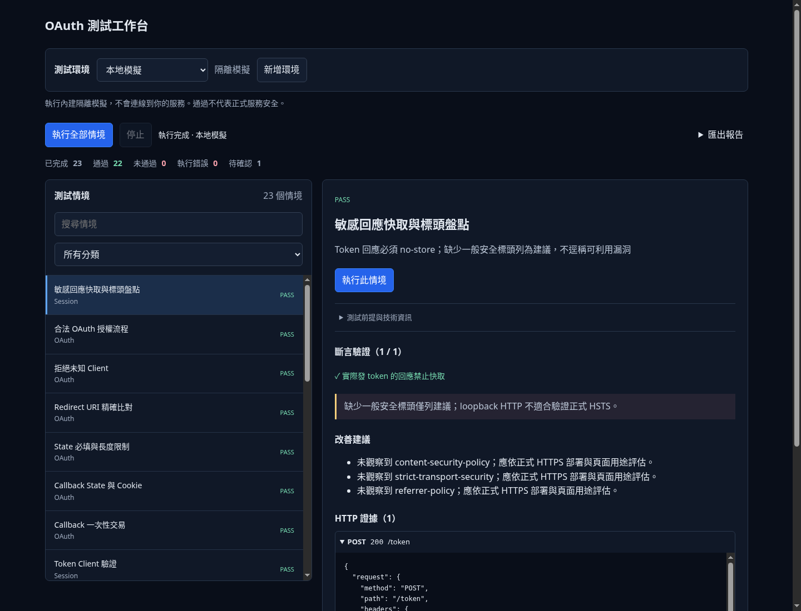
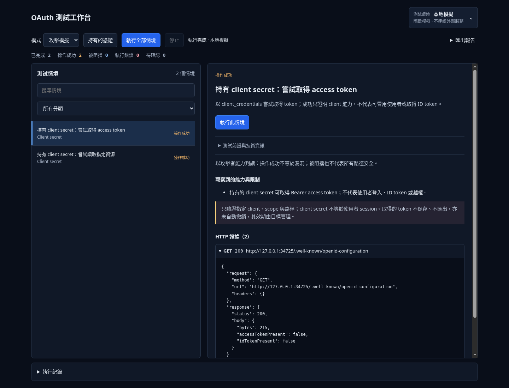
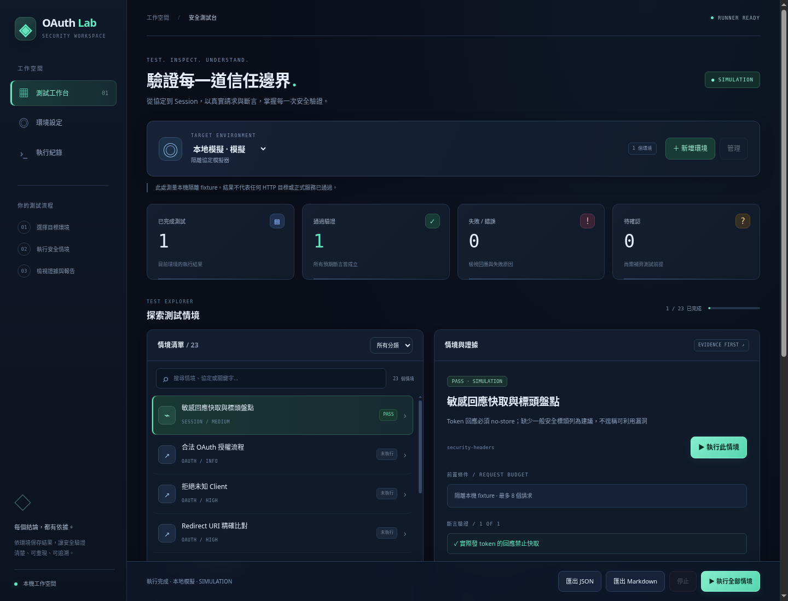

# OAuth-Security-Testing-Dashboard

以可追溯的 HTTP 證據學習與測試 OAuth 協定的本機安全實驗台。介面採繁體中文，包含情境分類、斷言結果、遮罩後的請求／回應、取消執行與 JSON / Markdown 報告。

## 啟動

目前以下載原始碼、在自己的電腦啟動 Web 服務為主，方便直接修改 `public/` 的畫面。

從原始碼執行需要 Node.js 24.5 以上；應用執行期只用 Node 內建模組，不需設定憑證。打包開發工具由 `npm ci` 按 lockfile 安裝。

```sh
git clone https://github.com/Ciren22007524/OAuth-Security-Testing-Dashboard.git
cd OAuth-Security-Testing-Dashboard
npm start
```

請在瀏覽器輸入啟動訊息中的本機位址（預設 `http://localhost:3000`）。**不要直接雙擊 `public/index.html` 來執行測試**：HTML 只是前端入口，測試與環境設定需要 Node API。直接開檔僅可預覽樣式，會顯示尚未連接執行器；靜態主機也不會提供測試 API。

CSS、JavaScript 與 API 使用相對路徑；若部署在子路徑，反向代理需將該前綴下的資源與 API 一起轉送 Node 服務，並保留對外 Host／Origin 的一致性。

服務只綁定 loopback，預設埠號 3000，可用 `PORT=3001 npm start` 調整。預設使用本機模擬器；使用者可自行新增、管理及切換多個 HTTP 或模擬環境，詳見 [環境管理](docs/ENVIRONMENTS.md)。儲存 HTTP 環境不會立即連線，執行時才測試所選目標。雲端 onboarding 不提供 localhost 預覽連結；可透過本機 HTTP 請求驗證服務。

```sh
npm run check
npm test
# 已安裝 Chromium 時，另可驗證完整介面流程
npm run test:browser
```

## 目前介面

頁首顯示目前環境名稱與目標摘要；點擊可開啟環境面板，切換、新增或編輯環境。選擇環境後，可搜尋／篩選情境，執行單項或全部測試，直接查看斷言及 HTTP 證據。執行紀錄、測試前提與報告匯出收在展開操作中；「未通過」與「執行錯誤」分開統計。結果只保留在目前頁面，重新整理會清空。

桌面版工作區固定在視窗內，左側情境與右側結果各自捲動；HTTP 回應隨右欄展開並自動換行，不再有額外的內層捲軸。切換情境會回到結果頂部。



## array-test 整合驗收

目前通用情境尚未適配 array-test 的真實登入／API 契約，不能將本機 fixture 測試當成 demo 驗收完成。下一階段以「分清應用／身分服務／API → 建立正常登入與受保護資料對照 → 逐項攻擊 → 證據與報告」落實，流程、現有差距與驗收清單見 [整合驗測流程](docs/ACCEPTANCE_FLOW.md)。

## 防禦驗證與攻擊模擬

保留原有防禦驗證，透過「模式」切換攻擊者視角。攻擊模式有 10 個可執行情境，涵蓋 client secret、access token、refresh token、授權碼重播與 PKCE。**環境只選目標，參數在各情境右側表單獨立填寫**；不共用憑證，也不自動沿用環境的 client ID。

選擇情境、填參數後按「執行此情境」。更改參數只清除該情境結果，草稿與憑證不存入環境設定或報告。

操作、OIDC 支援範圍與情境擴充方式見 [攻擊模式](docs/ATTACK_MODE.md)。這不是完整 OIDC conformance 或使用者冒用驗證。



## 選用：Windows 可攜式預覽

在 [Releases](https://github.com/Ciren22007524/OAuth-Security-Testing-Dashboard/releases) 下載 Windows x64 預覽 ZIP，解壓後雙擊 `OAuthSecurityLab-windows-x64.exe`。程式內嵌 Node、前端及測試服務，不需安裝 Node 或輸入 npm 指令；啟動後自動開啟瀏覽器，使用期間保留程式視窗即可。

這裡的 localhost 是使用者自己電腦上的內建服務，不是雲端工作區。會自動選擇可用埠號；環境設定保存在使用者的 AppData，不會寫進 EXE 或雲端 repo。

舊版可攜式預覽截圖：



截圖來自 Linux 單檔程式的實際瀏覽器驗證。Windows 預覽尚未程式碼簽章；Release 工作流程會在 Windows runner 實際執行獨立 EXE smoke test，通過後才發布。請參閱 [使用說明](docs/WINDOWS-QUICKSTART.txt)，不要把本機打包成功當作 Windows CI 已通過。

## 打包單檔執行檔

```sh
npm ci
npm run build:portable
```

在 Windows x64 會產生 EXE；Linux x64 產生 Linux 單檔，亦可用 `npm run build:portable -- --windows` 交叉產生 Windows 預覽檔。打包需下載官方 Node 授權文件；交叉打包另下載同版本 node.exe 並核對官方 SHA-256，保留 TLS 驗證。建置產物在 ignored `dist/`。

```sh
# 已產生本機平台執行檔後，驗證它在 repo 外啟動、載入介面並執行測試
npm run test:portable
```

GitHub 的 `Windows portable release` 工作流程在 tag 推送時執行 Windows 檢查／建置／EXE smoke test，成功後產生預覽 Release。手動執行工作流程僅建置 artifact，不自動發布。桌面入口在 `src/desktop-entry.js`，服務共用 `src/application.js`；原始碼 CLI 仍為 `src/server.js`。

## 可驗證的範圍

23 個情境涵蓋 client / redirect / state 驗證、callback cookie 與重播、Origin、refresh session 過期、並行輪替、30 秒重用寬限與撤銷、單裝置／全裝置登出、JWKS／discovery、限流、錯誤處理及安全標頭盤點。每個 HTTP 情境啟動自己的隔離模擬器；時鐘可注入，不必等待 30 秒。結果為 PASS / FAIL / INCONCLUSIVE / ERROR。缺少一般安全標頭僅列建議，不直接宣稱可利用漏洞。

**SIMULATION 通過不代表正式 auth-service 通過。** 模擬器是明確定義的協定 fixture，不是從私有服務複製的實作。Token endpoint 產生的是 opaque fixture 值；JWT 驗證情境另用 Node crypto 產生本機 ES256 簽章。JWT 驗證不是 `/token` 的職責。

儀表板內的瀏覽器 CORS 情境仍回報 INCONCLUSIVE，不會自動把其他環境的結果混入模擬結果。另提供可選的真實 auth-service 原始碼整合與 Chromium CORS 指令，詳見 [本機整合驗證](docs/LOCAL_INTEGRATION.md)。已驗證真實路由的 JWKS、discovery、logout、限流、並行輪替等行為；使用假 Google 與記憶體資料，不是正式 Google 登入或 D1 驗收。HTTP 環境提供 10 個公開／無 session 情境，結果標示 CUSTOM_HTTP，與模擬結果分開。執行 API 只接受已儲存的環境 ID，不接受臨時外部 URL。

## 隔離與證據

- 模擬情境最多 8 個請求，並行輪替最多 2 個；HTTP 情境最多 4 個請求且每目標至少間隔 500ms。Runner 一次只執行一個情境。
- 模擬情境使用獨立 session 狀態，完成後關閉 fixture。HTTP 檢查不帶 session，不執行登出／撤銷；redirect／state 合法對照交易由目標期限清理。
- Cookie、Authorization、token 與身份欄位於回傳前遮罩；不保存私鑰、不使用 analytics 或 localStorage，報告只由使用者下載。
- HTTP 證據保留實際 status、headers、body 與各項斷言。不能只因收到 401 / 403 就宣稱安全。
- 綁定 loopback，API 限制 Host 與 same-origin JSON，只測試已儲存環境的固定端點，不跟隨重新導向。

## 結構與後續工作

`src/fixture.js` 為協定模擬器，`src/runner.js` 為情境與報告，`src/server.js` 為控制 API，`public/` 為無框架介面，`test/` 為 Node 內建測試。

採用無相依套件的 JavaScript ES modules，而非交接文件建議的 React / TypeScript monorepo，以便目前環境可直接執行。語法檢查不是 TypeScript 型別檢查；現階段未提供獨立 lint / formatter。

詳見 [測試計畫](docs/TEST_PLAN.md) 與 [開發狀態](docs/STATUS.md)。已可建立自己的 HTTP 環境執行有界檢查；帶登入 session 的整合仍需隔離測試身份及額外設計，不能將模擬結果改標為實際目標結果。
